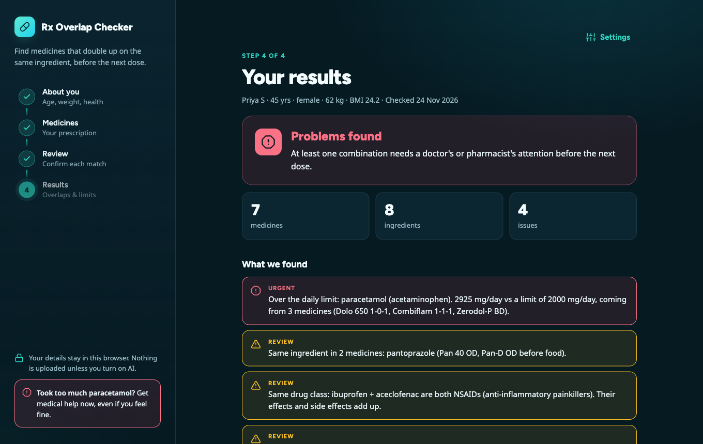
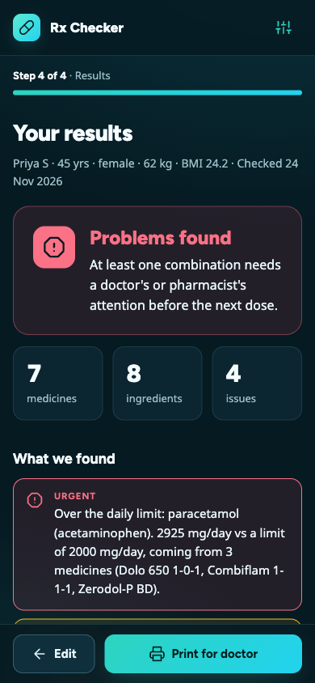

# Rx Overlap Checker

**Catch hidden ingredient overlaps in Indian prescriptions before the next dose.**

Many Indian brands are fixed-dose combinations: *Combiflam* is ibuprofen + paracetamol, *Zerodol-P* is aceclofenac + paracetamol, *Pan-D* is pantoprazole + domperidone. A patient can be prescribed three brands that all contain paracetamol, and nothing on the strips makes that obvious. Rx Overlap Checker reads the prescription, works out what's inside each brand, totals every ingredient per day, and flags overlaps, same-class duplicates and doses over a safe limit for that patient.

It works as a **consumer web app** and as a **REST API** that hospitals and telemedicine platforms can call before a doctor signs a prescription.



<p align="center"></p>

## Features

- **Reads Indian prescriptions as written**: brand names and doctor shorthand (`1-0-1`, `BD`, `TDS`, `HS`, `SOS`, `q6h`, `½`).
- **Indian brand → composition lookup**, with a fallback to the US NLM RxNorm database. The fallback rejects unconfident matches instead of guessing.
- **Per-patient limits**: adjusted for weight (children), liver disease or alcohol use, sex, and age 60+/65+.
- **Finds**: the same ingredient in several medicines, daily totals over the limit, two drugs from the same class (e.g. two NSAIDs), allergy-group matches (penicillin allergy + amoxicillin), and condition warnings (NSAIDs with kidney disease, and others).
- **Never says "ok" on missing data**: an unknown brand, a missing strength or a missing frequency gives `incomplete`, not a wrong total.
- **4-step guided form** with required fields, inline errors and a linked error summary. Accessible (WCAG AA contrast, keyboard, screen-reader labels) and mobile-first.
- **Optional AI**: Claude or a local Ollama model reads handwritten prescriptions and writes a review. Off by default; the rule engine works without it.
- **Private by default**: everything runs in the browser, and health details are kept only for the current tab.

## Quick start

Requires Node.js 20 or newer. No `npm install` is needed; there are no dependencies.

```bash
git clone https://github.com/saigagan99-sys/rx-overlap-checker.git
cd rx-overlap-checker
cp .env.example .env    # optional: add keys
npm start               # http://localhost:8787
npm test                # engine + server tests
```

Click **Fill an example** on step 2 to see it catch a paracetamol overlap.

## How it works

```
prescription text / photo
        │  parseLine()            "Combiflam 1-1-1" → name, 3 doses/day
        ▼
ingredient lookup                 Indian brand list → custom source → typed composition → RxNorm (guarded)
        │
        ▼
analyze()                         per-ingredient daily totals, limits for this patient,
        │                         same-class groups (curated + WHO ATC), allergy groups, conditions
        ▼
status: danger | incomplete | warning | ok   + alerts, suggestions for the doctor
```

| File | Purpose |
|---|---|
| `engine.js` | All checking logic. Shared by the browser and the server, with no dependencies. |
| `index.html` | The web app (vanilla JS, no build step). |
| `server.js` | Serves the app and the `/v1` API; holds API keys. |
| `data/brands-in.csv` | Starter list of 51 common Indian brands. |
| `test/` | `node:test` suites for the engine and the server. |

## Configuration

All keys live in `.env` on the server and never reach the browser. See [`.env.example`](.env.example).

| Variable | Purpose |
|---|---|
| `CLIENT_API_KEYS` | Comma-separated keys you issue to hospital/telemedicine clients (`x-api-key` header). **If empty, the API only answers requests from the same machine.** |
| `ANTHROPIC_API_KEY` / `OLLAMA_URL` | Optional AI for photo reading and reviews |
| `UI_AI_LIMIT_PER_HOUR` | AI calls per IP per hour from the web page (default 30) |
| `OPENFDA_API_KEY` | Optional; higher openFDA rate limit |
| `CUSTOM_SOURCE_URL` / `_HEADER` / `_KEY` | A paid drug database or your own service |
| `BRANDS_CSV` | Extra brand lists, e.g. the [Kaggle A-Z Medicine Dataset of India](https://www.kaggle.com/datasets/shudhanshusingh/az-medicine-dataset-of-india) (check its licence) |

## API: check before signing a prescription

```http
POST /v1/check
x-api-key: <client key>
content-type: application/json

{
  "patient": { "age": 70, "sex": "female", "weight_kg": 58, "conditions": ["kidney"], "allergies": ["sulfa"] },
  "medicines": [
    { "name": "Zerodol-P", "frequency": "BD" },
    { "name": "Combiflam", "frequency": "1-1-1" },
    { "name": "Custom Brand X", "ingredients": [{ "name": "paracetamol", "mg": 500 }], "doses_per_day": 2 }
  ]
}
```

```json
{
  "status": "warning",
  "alerts": [{ "level": "warning", "code": "duplicate_ingredient", "ingredients": ["acetaminophen"], "text": "Same ingredient in 3 medicines: ..." }],
  "suggestions": ["Combiflam contains paracetamol in addition to ibuprofen. Consider ibuprofen alone ..."],
  "ingredients": [{ "name": "acetaminophen", "mg_per_day": 2625, "reference_max_mg_per_day": 4000, "sources": ["..."] }],
  "incomplete": [],
  "unresolved": []
}
```

- **`status`**: `danger` > `incomplete` > `warning` > `ok`. Treat `incomplete` like `danger`, because the check couldn't see everything. A suggested integration: block **Sign** on `danger` or `incomplete` until the doctor enters an override reason, and show warnings inline.
- **Validation**: `patient.age` is required (0–120). Numbers must be JSON numbers (`"four"` or `"650mg"` → 400). Allowed `patient.conditions` values: `liver`, `alcohol`, `kidney`, `pregnant`, `breastfeeding`, `ulcer`, `heart`, `thinners`, `diabetes`, `asthma`.
- **Alert codes**: `over_limit`, `duplicate_ingredient`, `near_limit`, `same_class`, `patient_factor`, `incomplete`, `class_check_partial`.
- `GET /v1/lookup?q=Pan-D` returns the brand → composition lookup only.

## Deploying

Run `node server.js` behind any HTTPS reverse proxy. With **nginx**, pass the original host through, or the web page's AI calls are refused as cross-site:

```nginx
location / {
  proxy_pass http://127.0.0.1:8787;
  proxy_set_header Host $host;
}
```

The AI rate limit is kept in memory per process. Use a shared store if you run several instances.

## Data sources

- Indian brand compositions: starter list in `data/`. Extend it with your own or a licensed dataset.
- [NLM RxNorm / RxClass](https://lhncbc.nlm.nih.gov/RxNav/) for generic names and WHO ATC drug classes (free, no key).
- [openFDA](https://open.fda.gov/) drug labels for dosing text where no built-in limit exists.

## Limitations

- **Not a medical device and not medical advice.** The reference limits and brand list are starting points and need review by a pharmacist before clinical use. In India, clinical decision support software may fall under CDSCO's medical device software rules.
- It checks duplication, daily limits, drug classes, allergy groups and some conditions. It is **not** a full drug–drug interaction database.
- AI output is labelled as advisory and can be wrong.

## License

[MIT](LICENSE) © 2026 saigagan
